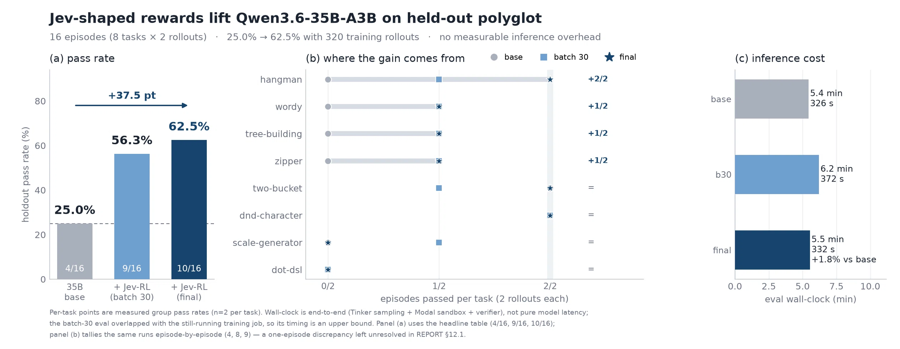

# 35B + Jev

**RL post-training with a decision-model-shaped reward, and best-of-k reranking, for Codex CLI on Terminal-Bench 2.**
Qwen3.6-35B-A3B as the agent · Torchcast Decision 31B (Jev-class) as the judge · Harbor + Codex CLI as the harness.

<p>


</p>


## TL;DR

| | Result | Verdict |
|---|---|---|
| **Base model swap** 9B → 35B-A3B, 37 TB2 tasks | 10.8% → **32.4%**, paired **+21.6 pt** (95% CI +8.1 to +36.5) | **significant** |
| **Reranking** k=3 with the decision model, 24 tasks | **+11.1 pt** (95% CI +2.8 to +20.8) | **significant** |
| **Reranking**, all 37 tasks | **+6.3 pt** (95% CI 0.0 to +13.5), 3× cost | marginal |
| **Jev-shaped GRPO** on 35B, held-out polyglot | 25.0% → **62.5%** (16 episodes) | **point estimate, not significant** (p≈0.22) |
| **RL transfer** to TB2 | 4/10 vs base 3/10, 5 trials unusable | **not measured** |



## How to read these numbers

* The evaluation resolves about **7.6 points** at 80% power on 37 tasks
  (`eval/noise_band.py`), and 31 of those 37 tasks are never solved by the small
  model — the addressable headroom on that benchmark is roughly 10-15 points.
* A **significant** row means the paired confidence interval clears zero *and*
  clears that resolution floor.
* The RL row is a **direction, not a result**: 320 rollouts, 8 training tasks,
  16 held-out episodes. It needs roughly 4× more rollouts and a larger held-out
  split before "+37.5 pt" can be quoted.
* The reward shaping is **not** the whole story. On-policy the judge separates
  passes from failures with AUC **0.72** (0.85 off-policy), so this is
  *Jev-shaped GRPO*, not "Jev makes the model smarter".

## Contents

- [Why this repo exists](#why-this-repo-exists)
- [Architecture](#architecture)
- [What is in the box](#what-is-in-the-box)
- [Reproduce](#reproduce)
- [Results in detail](#results-in-detail)
- [Limitations, stated plainly](#limitations-stated-plainly)
- [Costs](#costs)

## Why this repo exists

Small open models driven by Codex CLI fail on Terminal-Bench 2 in two distinct
ways: they cannot solve the task, and they cannot even *act* reliably (text-form
tool calls, rejected tools, crashed agents). This repository is an attempt to fix
both without renting a datacenter:

1. **Make the agent stronger** — RL-post-train it, with a judge that turns the
   verifier's sparse 0/1 into a shaped reward.
2. **Make the output better without training** — sample k candidates and let the
   same judge pick.

Both were measured against the same harness, the same task subsets, and a
pre-registered decision rule (`config/queue_rerank_hard.json`).

## Architecture

```
Codex CLI --/v1/responses--> LiteLLM (Modal) --/v1/chat/completions--> Tinker
    |                          protocol bridge                        Qwen3.6-35B-A3B
    +--> Modal sandbox (Terminal-Bench task) --> task verifier --> 0/1
```

Three pieces exist because the off-the-shelf path does not:

* **Codex CLI dropped `wire_api = "chat"`** ([openai/codex#7782](https://github.com/openai/codex/discussions/7782))
  and now speaks only the Responses API, while Tinker serves only
  `/chat/completions`. `deploy/litellm_modal.py` bridges the two
  (`custom_openai/` + `mode: chat`) and preserves function calls.
* **RL cannot go through Codex**: GRPO needs sampled tokens and their logprobs.
  `rl/loop.py` + `rl/bridge.py` run their own shell-agent loop against Tinker's
  `SamplingClient` and a Modal sandbox. Codex is used for evaluation only.
* **The decision model needed a gateway**: the bundled `torchcast_decision`
  server answers `/health` but hangs on POST through Modal's proxy.
  `deploy/torchcast_diag.py` shows the same POST returning in **0.10 s** on
  loopback; `deploy/torchcast_gateway.py` (FastAPI, 92 ms) is the fix.

## What is in the box

```
rl/      training and rollouts
         train_jev.py        Jev-shaped GRPO (the RL experiment)
         train_probe.py      plain GRPO on the verifier reward (baseline)
         sft.py              rejection-sampling SFT (the negative experiment)
         loop.py             rollout -> group advantage -> Tinker Datum
         bridge.py           task <-> RL env (tool schema, parsing, grading)
         envs.py             Modal sandbox backend
         screen.py           find tasks whose base pass rate is learnable
         eval_ckpt.py        score a checkpoint on a fixed task list
         analyze_shaping.py  did P(solves) carry information on-policy?
eval/    measurement
         run_eval.py         Harbor runner + pass@1/pass@k + results.tsv ledger
         noise_band.py       how large an effect this evaluation can resolve
         paired_compare.py   paired comparison of two runs on shared tasks
         jev_score.py        decision-model scores for existing trials
         jev_auc.py          does P(solves) separate passes from failures
         rerank_eval.py      best-of-k reranking metrics
         policy_search.py    offline search over selection rules
         calibrate_threshold.py  accept-threshold sweep
         feasibility.py      go / adjust / pivot judge with pre-registered rules
         autoresearch.py     queue driver: run experiments, keep the best
deploy/  Modal deployments (bridge, 31B server, gateway, diagnostics)
config/  Codex provider configs, tool-contract prompt, pre-registered queue
docs/    analysis, data notes, figures, and the JSON behind every table
```

## Reproduce

```bash
# 0) environments
pip install tinker transformers modal "harbor[modal]"   # harbor 0.26.0 used here
export TINKER_API_KEY=...  LITELLM_API_KEY=...

# 1) deploy the bridge and the decision model
modal secret create tinker-secrets TINKER_API_KEY=$TINKER_API_KEY LITELLM_API_KEY=$LITELLM_API_KEY
modal deploy deploy/litellm_modal.py       # Responses <-> chat bridge
modal deploy deploy/torchcast_modal.py     # Torchcast Decision 31B on A100-80GB

# 2) evaluate a model on a task subset (writes one row to results.tsv)
python eval/run_eval.py --tag qwen36 --model qwen36 \
  --codex-config config/codex_tinker_litellm.toml \
  --tasks eval/ceiling10.txt --k 1 --concurrency 5 \
  --prompt-template config/codex_prompt.j2

# 3) RL with a Jev-shaped reward
RL_ENV=modal RL_MAX_TURNS=12 python rl/train_jev.py \
  --model Qwen/Qwen3.6-35B-A3B --tasks eval/rl_train_35b.txt \
  --batches 40 --group 4 --tasks-per-batch 2 --alpha 0.3 --save-every 5

# 4) score the checkpoint on a held-out split
python rl/screen.py --tasks eval/holdout8_ext.txt --group 2 \
  --model Qwen/Qwen3.6-35B-A3B --ckpt tinker://...

# 5) was the shaping informative?
python rl/analyze_shaping.py --ckpt rl/jev_rl_ckpt.json
```

## Results in detail

**Base model swap** (`eval/paired_compare.py`, 37 shared tasks):

| | pass@1 |
|---|---|
| Qwen3.5-9B | 10.8% |
| Qwen3.6-35B-A3B | **32.4%** |
| paired delta | **+21.6 pt**, 95% CI **[+8.1, +36.5]** |

**Reranking, 37 tasks × 3 candidates** (`eval/rerank_eval.py`): pass@1 31.5% →
selected **37.8%** (+6.3 pt, CI 0.0 to +13.5); pass@3 ceiling 43.2%, so the picker
captures **54%** of the headroom. On the balanced 24-task subset: **+11.1 pt**
(CI +2.8 to +20.8), of which **+8.3 pt** comes from selection rather than extra
sampling.

**Jev-shaped GRPO**, held-out polyglot (8 tasks × 2 rollouts):

| | passed |
|---|---|
| 35B base | 4/16 = 25.0% |
| + Jev-RL (batch 30) | 9/16 = 56.3% |
| + Jev-RL (final) | **10/16 = 62.5%** |

Five tasks improved, two unchanged, one returned to baseline. Sign test on the six
discordant tasks: p ≈ 0.22.

## Limitations, stated plainly

* **The RL result is a signal, not a result.** 320 rollouts / 2,860 decision
  points; a normal post-training run is 10^4-10^5 rollouts.
* **The evaluation is coarse.** ~7.6 pt resolution; 31/37 TB2 tasks are a hard
  floor for the 9B, which caps what any training method can show there.
* **Reranking costs 3× inference** and its full-set CI touches zero. No threshold
  or margin rule beat plain argmax (`docs/policy_search.json`).
* **Many trials died on harness defects, not model behaviour**: Codex rejects
  `apply_patch` for non-OpenAI providers, the tool-name contract is easy to get
  wrong, and `code-from-image` returns a persistent upstream 400. Those trials
  score 0 and depress every number above.
* **Known bug, unfixed**: a rollout's `asyncio.wait_for` timeout does not fire
  because `envs.ModalTask` uses blocking Modal calls and blocks the event loop.
  Fix: `sandbox.exec.aio`. This is why runs stalled after 4-6 batches until
  `--save-every` was added.

## Costs

Tinker ≈ $55 (training + evaluation tokens) · Modal ≈ $10 (CPU sandboxes plus one
A100-80GB for the decision model) · **≈ $65 total**.

## Raw material

`jobs/` (≈465 MB of per-trial logs and verifier output) is not committed. Every
table above is reproducible from the JSON in `docs/` and from `results.tsv`.
