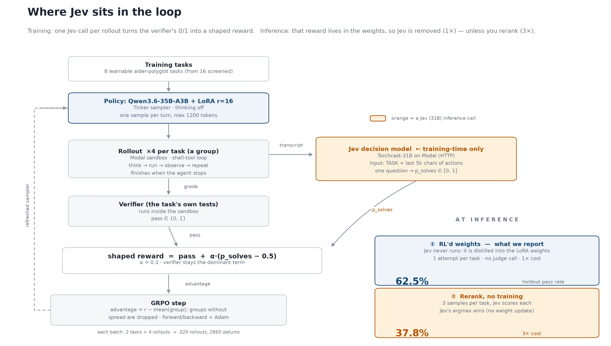

# 35B + Jev 鈥?RL post-training and decision-model reranking for Codex CLI on Terminal-Bench 2

Two ways to make a small open model better on Terminal-Bench 2, measured with a
real harness (Harbor + Codex CLI + a task's own verifier):

1. **RL post-training with a decision-model-shaped reward.** Qwen3.6-35B-A3B is
   trained with GRPO on polyglot tasks; a Torchcast Decision 31B (Jev-class) model
   scores every rollout with `P(solves)`, turning the verifier's 0/1 into a shaped
   reward. On a held-out polyglot split this moved pass rate **25.0% 鈫?62.5%**
   (16 episodes: 8 tasks 脳 2 rollouts) 鈥?a large point estimate that is **not yet
   statistically significant** (sign test p 鈮?0.22).
2. **Reranking at inference, no training.** Sample k = 3 candidates per task and
   keep the one the same decision model scores highest. Across 37 Terminal-Bench-2
   tasks with the 35B: **31.5% 鈫?37.8%** (**+6.3 pt**, 95% CI 0.0 to +13.5, 3脳 cost);
   on a balanced 24-task subset **+11.1 pt (95% CI +2.8 to +20.8)**.




## What is actually established

| Claim | Number | Status |
|---|---|---|
| Base model swap 9B 鈫?35B-A3B, same harness, 37 TB2 tasks | **10.8% 鈫?32.4%**, paired **+21.6 pt** (95% CI +8.1 to +36.5) | significant |
| Reranking with the decision model, 24 tasks 脳 3 candidates | **+11.1 pt** (95% CI +2.8 to +20.8) | significant |
| Reranking, all 37 tasks 脳 3 candidates | **+6.3 pt** (95% CI 0.0 to +13.5) | marginal |
| Jev-shaped GRPO on 35B, held-out polyglot (16 episodes) | **25.0% 鈫?62.5%** | **not significant** (n=8 tasks) |
| Same checkpoint transferred to TB2 (10 tasks) | 4/10 vs base 3/10, 5 trials unusable | **not measured** |

The evaluation itself resolves about **7.6 points** at 80% power on 37 tasks, and
31 of those 37 tasks are never solved by the small model, so the addressable
headroom on that benchmark is roughly 10鈥?5 points. Anything below ~8 pt cannot be
confirmed here.

## Architecture

```
Codex CLI 鈹€鈹€/v1/responses鈹€鈹€鈻?LiteLLM (Modal) 鈹€鈹€/v1/chat/completions鈹€鈹€鈻?Tinker
    鈹?                         protocol bridge                        Qwen3.6-35B-A3B
    鈹斺攢鈹€鈻?Modal sandbox (Terminal-Bench task) 鈹€鈹€鈻?task verifier 鈹€鈹€鈻?0/1
```

Three things had to be built because the off-the-shelf path does not exist:

* **Codex CLI dropped `wire_api = "chat"`** (openai/codex#7782) and now speaks only
  the Responses API, while Tinker serves only `/chat/completions`.
  `deploy/litellm_modal.py` bridges the two (`custom_openai/` + `mode: chat`) and
  preserves function calls.
* **RL training cannot go through Codex**: GRPO needs the sampled tokens and their
  logprobs. `rl/loop.py` + `rl/bridge.py` run their own shell-agent loop against
  Tinker's `SamplingClient` and a Modal sandbox, so Codex is used only for
  evaluation, never for training.
* **The decision model needed a gateway**: the bundled `torchcast_decision` server
  answers `/health` but hangs on POST when exposed directly through Modal's proxy.
  `deploy/torchcast_diag.py` shows the same POST returning in 0.10 s on loopback;
  `deploy/torchcast_gateway.py` (FastAPI, 92 ms) is the fix.

## Repo layout

```
rl/     training and rollout code
        train_jev.py      Jev-shaped GRPO (the RL experiment)
        train_probe.py    plain GRPO on the verifier reward (baseline)
        sft.py            rejection-sampling SFT (the negative experiment)
        loop.py           rollout -> group advantage -> Tinker Datum
        bridge.py         task <-> RL env (tool schema, parsing, grading)
        envs.py           Modal sandbox backend
        screen.py         find tasks whose base pass rate is learnable
        eval_ckpt.py      score a checkpoint on a fixed task list
        analyze_shaping.py  did P(solves) carry information on-policy?
eval/   measurement
        run_eval.py       Harbor runner + pass@1 / pass@k + results.tsv ledger
        noise_band.py     how large an effect this evaluation can even resolve
        paired_compare.py paired comparison of two runs on shared tasks
        jev_score.py      decision-model scores for existing trials
        jev_auc.py        does P(solves) separate passes from failures
        rerank_eval.py    best-of-k reranking metrics
        policy_search.py  offline search over selection rules
        calibrate_threshold.py  accept-threshold sweep
        feasibility.py    go / adjust / pivot judge with pre-registered rules
        autoresearch.py   queue driver: run experiments, keep the best
deploy/ Modal deployments (protocol bridge, 31B server, gateway, diagnostics)
config/ Codex provider configs, the tool-contract prompt, a pre-registered queue
docs/   analysis, data notes, and the JSON numbers behind every table
```

## Reproduce

```bash
# 0) environments
pip install "tinker" "transformers" "modal" "harbor[modal]"
export TINKER_API_KEY=...  LITELLM_API_KEY=...   # see deploy/
python -c "import harbor" && harbor --version    # 0.26.0 used here

# 1) deploy the bridge and the decision model
modal secret create tinker-secrets TINKER_API_KEY=$TINKER_API_KEY LITELLM_API_KEY=$LITELLM_API_KEY
modal deploy deploy/litellm_modal.py
modal deploy deploy/torchcast_modal.py

# 2) evaluate any model on the task subset (writes results.tsv)
python eval/run_eval.py --tag qwen36 --model qwen36 \
  --codex-config config/codex_tinker_litellm.toml \
  --tasks eval/ceiling10.txt --k 1 --concurrency 5 \
  --prompt-template config/codex_prompt.j2

# 3) RL with a Jev-shaped reward
RL_ENV=modal RL_MAX_TURNS=12 python rl/train_jev.py \
  --model Qwen/Qwen3.6-35B-A3B --tasks eval/rl_train_35b.txt \
  --batches 40 --group 4 --tasks-per-batch 2 --alpha 0.3 --save-every 5

# 4) score the checkpoint on a held-out split
python rl/screen.py --tasks eval/holdout8_ext.txt --group 2 \
  --model Qwen/Qwen3.6-35B-A3B --ckpt tinker://...

# 5) was the shaping informative?
python rl/analyze_shaping.py --ckpt rl/jev_rl_ckpt.json
```

Every number in this README is reproduced by the JSON under `docs/` and the
`results.tsv` ledger; `jobs/` (the raw trial logs, ~465 MB) is not committed.

## Limitations, stated plainly

* **RL result is a signal, not a result.** 320 rollouts, 8 training tasks, 16
  held-out episodes. It needs ~4脳 more rollouts and a larger held-out split
  before the +37.5 pt can be quoted as anything but a point estimate.
* **The reward shaping is not the whole story.** On-policy, the decision
  model separates passes from failures with AUC **0.72** (vs 0.85 off-policy), so
  this is best described as *Jev-shaped GRPO*, not "Jev makes the model smarter".
* **Reranking costs 3脳 inference** and its full-set confidence interval touches
  zero. No threshold or margin rule beat plain argmax (`docs/policy_search.json`).
* **Evaluation resolution is ~7.6 pt**; 31/37 TB2 tasks are a hard floor for the
  9B, which bounds what any training method can show there.
* **Plenty of trials died on harness defects**, not model behaviour: Codex's
  `apply_patch` is rejected for non-OpenAI providers, its tool-name contract is
  easy to get wrong, and `code-from-image` returns a persistent upstream 400.
  Those trials score 0 and depress every number above.

## Costs (this work)

Tinker 鈮?$55 (training + evaluation tokens), Modal 鈮?$10 (CPU sandboxes, one
A100-80GB for the decision model), total 鈮?$65.
